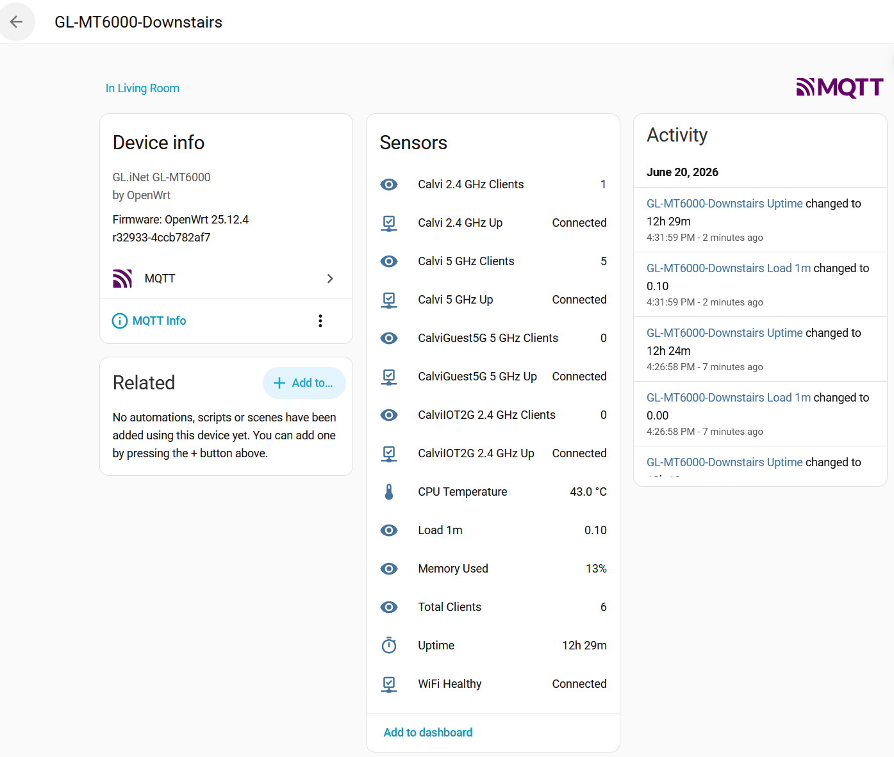

# openwrt-mqtt-haos

**Version 1.2.8** — publishes OpenWrt router Wi-Fi and system statistics to Home Assistant using MQTT discovery, with device-wide availability monitoring and automatic reconnection.

Tested on GL-MT6000 running Alpine-based OpenWrt.

## v1.2.7: wired routers and mwan3 failover monitoring

Install this publisher on **OpenWrt-101**, where mwan3 runs, to monitor end-to-end failover. Wi-Fi tools are optional; no `iw` installation is required on a wired VM. Existing Wi-Fi and system entities retain their IDs and topics.

With native nftables mwan3 configured, discovery adds interface status and online-duration sensors, policy member percentages, and the active connection for each configured policy/address family. For the documented setup this gives:

- Status and online duration for `wan`, `mobile`, `wan6`, `mobile6`.
- `failover`: wan/mobile percentages and active IPv4 connection.
- `failover6`: wan6/mobile6 percentages and active IPv6 connection.

Online duration uses the same readable text format as router Uptime: `2m 34s`, `2h 32m`, or `4d 22h`. v1.2.8 removes the previous seconds unit and duration device class; rerun discovery (or restart the publisher) to refresh existing entities. Percentages are mwan3 policy allocations, **not measured bandwidth usage**. Zero percent means standby. Multiple active members are listed when load balancing. Data comes from `ubus -t 5 call mwan3 status`, the structured RPC used by LuCI, not the CLI summary that can omit IPv6 policies. This requires native mwan3's RPC and `ubus`/`jsonfilter`.

The retained JSON topic is `openwrt/{id}/mwan3/state`. Sensors require both the device availability and `openwrt/{id}/mwan3/availability` to be online. A failed/stopped RPC marks only mwan3 sensors unavailable, without leaving stale healthy readings or taking unrelated system sensors offline. Updates follow the existing fast poll (default 60 seconds); they are monitoring only and do not control routing. Restart discovery after adding interfaces or policies. Routers with no mwan3 config skip monitoring.

### Install on VM101

```sh
wget -O /tmp/openwrt_mqtt.sh https://raw.githubusercontent.com/JCalvi/openwrt-mqtt-haos/main/openwrt_mqtt.sh
sh -n /tmp/openwrt_mqtt.sh && cp /tmp/openwrt_mqtt.sh /root/openwrt_mqtt.sh
chmod 755 /root/openwrt_mqtt.sh
/root/openwrt_mqtt.sh install
```

Enter your existing HA MQTT broker details. For an already configured publisher use the noninteractive upgrade instructions below instead. In HA, find the **OpenWrt-101** MQTT device. Verify WAN unplug/reconnect changes both active-connection sensors after a poll. Live router/HA validation is required; local fixtures do not replace that check.

## Screenshot



## Overview

This script runs as a background daemon on your OpenWrt router and publishes WiFi and system stats to an MQTT broker. Home Assistant auto-discovers all sensors via MQTT discovery — no manual sensor configuration needed.

It uses two publish speeds:
- **Fast (default 60s)** — client counts and WiFi up/down status, published whenever something changes
- **Slow (default 300s)** — CPU temperature, memory usage, load average and uptime, published on a heartbeat timer

Fast telemetry uses **independent change detection for the main state and each SSID**. If one SSID's client count changes, only that SSID's MQTT topic is published; unchanged topics stay silent. This reduces the number of short-lived MQTT connections and Mosquitto connection logs without changing the Home Assistant entities, MQTT topics or sampling intervals. The daemon separately publishes a retained `online` heartbeat on each fast poll using a **persistent MQTT connection**, with a retained `offline` MQTT Last Will (LWT). This shared availability topic covers **all** the sensors on the device, without Home Assistant automations. The broker detects an unexpected connection loss using MQTT keepalive (60 seconds). On a clean service stop, the service explicitly publishes `offline`.

If the MQTT broker is temporarily unavailable, the daemon retries. After reconnection it republishes discovery and current readings. Unsuccessful data publications are retried instead of being marked complete.

### v1.2.6: automatic orphan cleanup and reliable shutdown

When older versions stopped, OpenWrt's `procd` could terminate the main daemon while leaving its shell-pipeline children (or their persistent MQTT availability publisher) running. This could produce extra MQTT connections and competing retained availability messages.

v1.2.6 replaces the foreground shell pipeline with a tracked, FIFO-connected producer and persistent publisher. A TERM/INT/HUP handler stops both child processes and removes the FIFO. The init service also runs `cleanup-orphans` automatically **after stopping the old procd instance** and **before a fresh start**, so upgrading and restarting removes leftover processes from v1.2.4/v1.2.5 without manually finding or killing PIDs.

The cleanup checks the exact OpenWrt script daemon command and the matching retained availability topic before signalling a process. It does not print MQTT command-line arguments or passwords. MQTT configuration, topics, entity IDs, and publishing intervals are unchanged.

For **each router**, install the new script using the noninteractive upgrade instructions below; `install-service` updates the service hooks, and the subsequent `restart` triggers automatic cleanup. Do not run the cleanup command manually during normal operation.

Tests:

```sh
sh tests/test_telemetry_publish.sh
sh tests/test_service_lifecycle.sh
```

### v1.2.5: fewer MQTT connections

Earlier versions cached one combined hash for all fast readings. Whenever any SSID's client count changed, the script republished the main state and **every** SSID, opening a new MQTT connection for each topic.

v1.2.5 maintains a separate hash in `/tmp` for each topic. It only opens a new short-lived MQTT connection for a topic whose payload has actually changed. **All existing topics, discovery unique IDs and retained values remain unchanged.** Cached hashes are cleared when the daemon reconnects, so the current states are republished after an outage. Failed publications are not cached and are retried.

The separate long-lived MQTT availability connection and its retained offline Last Will are unchanged. Discovery still uses individual publish connections when the service starts or reconnects.

To run the no-broker regression test from a checkout:

```sh
sh tests/test_telemetry_publish.sh
```

---

## Sensors

| Sensor | Topic | Update rate |
|--------|-------|-------------|
| Per-SSID client count | `openwrt/{id}/ssid/{ssid}/state` | Fast (60s) |
| Per-SSID up/down | `openwrt/{id}/ssid/{ssid}/state` | Fast (60s) |
| Total clients | `openwrt/{id}/state` | Fast (60s) |
| WiFi Healthy | `openwrt/{id}/state` | Fast (60s) |
| CPU Temperature | `openwrt/{id}/slow_state` | Slow (300s) |
| Memory Used % | `openwrt/{id}/slow_state` | Slow (300s) |
| Load 1m | `openwrt/{id}/slow_state` | Slow (300s) |
| Uptime | `openwrt/{id}/slow_state` | Slow (300s) |

Uptime displays as:
- `2m 34s` — under 1 hour
- `3h 12m` — under 1 day
- `6d 11h` — 1 day or more

SSIDs are auto-detected from `iw dev` at discovery time. Each SSID gets its own pair of sensors (clients + up/down). The device ID is derived from the router hostname.

---

## Requirements

- OpenWrt with `apk` packaging (tested on OpenWrt 25.x / GL-MT6000)
- `mosquitto-client-nossl` — installed automatically by the script
- `iw` — optional, required only for Wi-Fi readings
- `uci` — included in OpenWrt by default
- Home Assistant with the MQTT integration enabled and a broker (e.g. Mosquitto add-on)

---

## Install

```sh
# Download the script to the router
wget -O /root/openwrt_mqtt.sh https://raw.githubusercontent.com/JCalvi/openwrt-mqtt-haos/main/openwrt_mqtt.sh
chmod +x /root/openwrt_mqtt.sh

# Run the installer
/root/openwrt_mqtt.sh install
```

The installer will:
1. Auto-install `mosquitto-client-nossl` via `apk` if not already present
2. Prompt for MQTT configuration, showing defaults in brackets — press Enter to accept
3. Write config to `/etc/config/openwrt_mqtt` via UCI
4. Install and enable a procd init service at `/etc/init.d/openwrt_mqtt`
5. Ensure required files are listed once in `/etc/sysupgrade.conf` (without changing other entries)
6. Ensure `/etc/rc.local` contains exactly one `/etc/init.d/openwrt_mqtt start` command **before** `exit 0`
7. Publish MQTT discovery payloads so Home Assistant registers all sensors
8. Publish initial state immediately (no waiting for the first poll cycle)
9. Start the daemon

---

## Upgrade from an earlier version

The following **noninteractive upgrade** preserves your current MQTT credentials, UCI configuration, MQTT topics, and Home Assistant entity IDs:

```sh
# Back up the existing script.
cp /root/openwrt_mqtt.sh /root/openwrt_mqtt.sh.bak

# Fetch the latest version.
wget -O /root/openwrt_mqtt.sh https://raw.githubusercontent.com/JCalvi/openwrt-mqtt-haos/main/openwrt_mqtt.sh
chmod 755 /root/openwrt_mqtt.sh

# Update the service, sysupgrade preservation and rc.local fallback without config prompts.
/root/openwrt_mqtt.sh install-service
/etc/init.d/openwrt_mqtt restart

# Verify.
/root/openwrt_mqtt.sh version
/etc/init.d/openwrt_mqtt status
sysupgrade -l | grep -E 'openwrt_mqtt|rc.local'
grep -n 'openwrt_mqtt start' /etc/rc.local
```

For rollback, restore `/root/openwrt_mqtt.sh.bak` and rerun the previous version's installer to restore its original service script if needed. On v1.2.6, `install-service` does **not** prompt for or change the UCI MQTT settings.

---

## Configuration

Config is stored in `/etc/config/openwrt_mqtt` and managed via UCI:

```
config mqtt
        option host '192.168.1.20'
        option user 'openwrt'
        option password 'yourpassword'
        option discovery_prefix 'homeassistant'
        option poll_interval '60'
        option heartbeat '300'
```

| Option | Description | Default |
|--------|-------------|---------|
| `host` | MQTT broker IP or hostname | `192.168.1.20` |
| `user` | MQTT username | `openwrt` |
| `password` | MQTT password | _(empty)_ |
| `discovery_prefix` | Home Assistant MQTT discovery prefix | `homeassistant` |
| `poll_interval` | Seconds between fast state checks (clients, WiFi) | `60` |
| `heartbeat` | Seconds between slow state publishes (temp, memory, load, uptime) | `300` |

You can edit the config directly with UCI:

```sh
uci set openwrt_mqtt.@mqtt[0].host='192.168.1.5'
uci commit openwrt_mqtt
```

Telemetry options are re-read each poll. After changing connection-related values (broker host, credentials, or discovery prefix), **restart the service** to replace the persistent MQTT/LWT connection.

To re-run the interactive config prompts at any time:

```sh
/root/openwrt_mqtt.sh install
```

Re-running install is safe — it pre-fills all prompts with current values so you can just change what you need.

---

## Service

The script installs itself as a procd init service that starts automatically on boot and restarts if it crashes.

```sh
# Start / stop / restart
/etc/init.d/openwrt_mqtt start
/etc/init.d/openwrt_mqtt stop
/etc/init.d/openwrt_mqtt restart

# Enable / disable on boot
/etc/init.d/openwrt_mqtt enable
/etc/init.d/openwrt_mqtt disable
```

The service runs `/root/openwrt_mqtt.sh daemon` which loops indefinitely, maintaining the availability connection and sleeping for `poll_interval` seconds between polls. It restarts on unexpected failure, automatically terminates its child processes on shutdown, removes legacy orphans during service restart, and advertises `offline` on clean shutdown.

```sh
# Verify configuration, service, and version.
/root/openwrt_mqtt.sh version
/root/openwrt_mqtt.sh status
/etc/init.d/openwrt_mqtt status
```

**Availability test:** run `/etc/init.d/openwrt_mqtt stop`. All sensors using `openwrt/{device_id}/availability` should become unavailable in Home Assistant. Run `/etc/init.d/openwrt_mqtt start` to recover.

Logs are available via:

```sh
logread | grep openwrt_mqtt
```

---

## Commands

| Command | Description |
|---------|-------------|
| `install` | Full interactive install: deps, config, service, discovery, publish |
| `install-service` | Noninteractive service update; enables procd, maintains sysupgrade preservation and rc.local boot fallback |
| `offline` | Publish retained `offline` (used by the service on clean stop) |
| `discovery` | Re-publish MQTT discovery payloads (run after adding a new SSID) |
| `publish` | Publish current state once and exit |
| `daemon` | Run as a continuous polling daemon (used by the service) |
| `status` | Show current config, detected SSIDs, and live state |
| `version` | Print version number |

### Re-running discovery

If you add a new SSID or change your network setup, re-run discovery to register the new sensors in Home Assistant:

```sh
/root/openwrt_mqtt.sh discovery
```

### Checking status

```sh
/root/openwrt_mqtt.sh status
```

This shows the current config, all detected SSIDs, and the last fast/slow state payloads without publishing anything.

---

## MQTT Topics

| Topic | Contents |
|-------|----------|
| `openwrt/{device_id}/availability` | Retained `online` / `offline`, shared by all device sensors, with persistent MQTT LWT |
| `openwrt/{device_id}/state` | `{"healthy": true, "clients_total": 24}` |
| `openwrt/{device_id}/slow_state` | `{"uptime": 12345, "load1": "0.09", "memory_used_pct": 14, "cpu_temp": 43}` |
| `openwrt/{device_id}/ssid/{ssid_id}/state` | `{"ssid": "MyWiFi", "band": "24", "ifname": "phy0-ap0", "up": true, "clients": 18}` |

`{device_id}` is the router hostname converted to lowercase with special characters replaced by hyphens (e.g. `GL-MT6000-Upstairs` → `gl-mt6000-upstairs`).

---

## Firmware upgrades and persistence

`install` and `install-service` automatically ensure these entries exist **once** in `/etc/sysupgrade.conf`:

```text
/root/openwrt_mqtt.sh
/etc/config/openwrt_mqtt
/etc/init.d/openwrt_mqtt
/etc/rc.local
```

Existing `sysupgrade.conf` entries and comments are preserved. The init service is also enabled. **Since v1.2.4 the installer automatically maintains an additional `/etc/rc.local` fallback**, placing this line before the standard `exit 0`:

```sh
/etc/init.d/openwrt_mqtt start
```

The installer consolidates duplicate standalone start lines and otherwise preserves existing `rc.local` commands. It creates `rc.local` if missing and ensures it is executable. Running `install` or `install-service` repeatedly does not append duplicate lines.

The normal **procd** service remains the primary way MQTT starts and is supervised. `rc.local` provides a secondary start attempt if a firmware upgrade drops the service-enable flag. **Use `start`, not `restart`**, so the fallback does not deliberately restart an already running service. This does not guarantee recovery if the script or its dependencies are absent after an upgrade.

**Important:** `sysupgrade.conf` preserves **files, not installed packages**. During Attended Sysupgrade, ensure required packages such as `mosquitto-client-nossl` are included in the firmware build. If you also use SFTP/FileBrowser, preserve `openssh-sftp-server` in your firmware package selection. Verify functionality after reboot.

---

## Uninstall

```sh
/etc/init.d/openwrt_mqtt stop
/etc/init.d/openwrt_mqtt disable
rm /etc/init.d/openwrt_mqtt
rm /root/openwrt_mqtt.sh
uci delete openwrt_mqtt.@mqtt[0]
uci commit openwrt_mqtt
rm /etc/config/openwrt_mqtt
```

