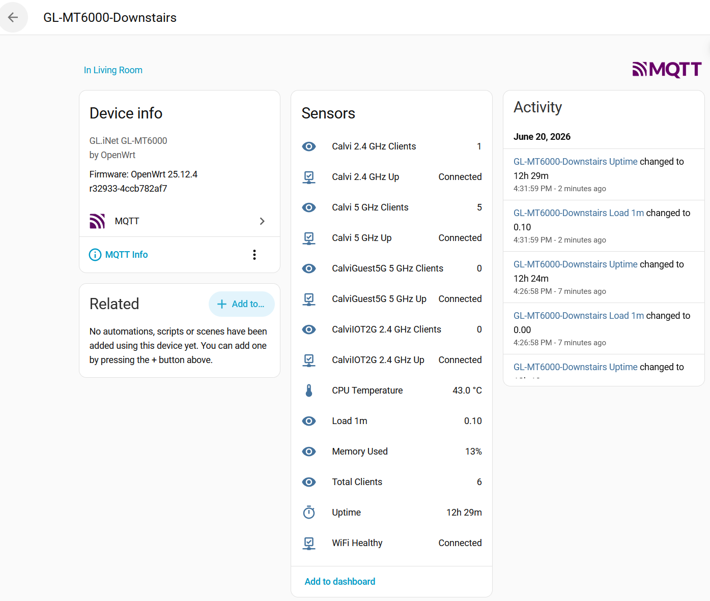

# openwrt-mqtt-haos

**Version 1.4.1** — publishes OpenWrt Wi-Fi, system, MWAN and optional ZTE MF833V mobile-modem readings to Home Assistant using MQTT discovery.

Tested on GL-MT6000 running Alpine-based OpenWrt.

## v1.4.1: fix Unknown update entity

Home Assistant strictly rejects extra fields in an MQTT Update JSON payload. v1.4.0 included a diagnostic `status` field, so HA could show the diagnostic sensor while leaving the update entity Unknown. v1.4.1 publishes that status separately on `openwrt/{id}/update/status` and keeps only supported fields on `update/state`. Existing entity IDs are preserved and discovery migrates the diagnostic sensor automatically. There is no new polling or timer. An added regression test checks the update payload's keys against HA's supported schema.

If already running v1.4.0, run `/root/openwrt_mqtt.sh update` in SSH after the release manifest is published. The manual updater works even when HA cannot parse its update entity. procd respawns the telemetry daemon; the existing command listener refreshes itself on its next handled request, or restart the service to refresh both instances immediately.

## v1.4.0: automatic local modem detection and HA updates

The same script can run on all routers. Modem polling requires saved modem credentials and a **direct IPv4 route to a network device with USB sysfs ancestry**. A route through another gateway is rejected. No password is copied between routers. `configure-modem` now selects `enabled='auto'`; existing `enabled='1'` configurations also receive the local USB check. `enabled='0'` explicitly disables polling. Routers without credentials skip modem discovery and polling. Previously configured modem entities become unavailable while the USB modem is absent and recover at the next normal poll when reconnected. Detection does not change routes, firewall rules or failover settings.

Each router gets an **MQTT Publisher** Update entity and a **Publisher Update Status** diagnostic sensor in its existing Home Assistant device. The entity reports installed/latest publisher versions and provides HA's manual Install control when a newer version is available. It updates this script, **not OpenWrt firmware**. There are no automatic installations. Each router must first receive v1.4.0 and the updated init service using the one-time upgrade procedure below; v1.3.0 cannot update itself from HA.

Version checks use a small HTTPS manifest every six hours. A persistent MQTT subscriber waits for commands without polling; normal Wi-Fi/modem telemetry remains at its existing interval. Between version checks, cached state avoids JSON parsing and extra MQTT update publications. These changes aim to keep idle overhead small; exact CPU usage has not been measured on the routers and is not guaranteed unchanged.

An Install request re-fetches `release.json`, accepts only a newer numeric version, downloads from the manifest's immutable repository commit, and validates the SHA-256, shell syntax and embedded version. It then atomically replaces the script, saves the previous file as `/root/openwrt_mqtt.sh.bak`, and signals the telemetry daemon for procd to respawn. The updater reloads its new code too. A failed download or validation leaves the installed script unchanged and reports failure. This is not a signed release or automatic runtime rollback: HTTPS and repository access are the trust boundary. Restore the backup manually if a validated release has a runtime defect.

Only the exact non-retained MQTT payload `INSTALL` on `openwrt/{id}/update/install` is accepted. No command-supplied URL or shell text is executed. Restrict broker write access to these command topics to trusted HA/admin accounts: this authorizes a root-owned script update. Keep the repository's `release.json` pinned to the tested script commit and hash, publishing it only after tests pass. Future releases requiring new packages or service changes need an explicit migration; this updater replaces the publisher script only.

The noninteractive `install-service` command installs `curl`, `ca-bundle`, `jsonfilter` and `mosquitto-client-nossl`, preserving UCI settings, then creates both supervised service instances. Internet access is needed for release checks and updates. An unreachable repository does not stop telemetry. Existing firewall restrictions remain effective.

Manual alternatives:

```sh
/root/openwrt_mqtt.sh check-update
/root/openwrt_mqtt.sh update
```

After installing on each router, check its HA device for **MQTT Publisher**. The first release check runs at startup; later checks are six hours apart. An update entity in HA is the manual update control, rather than a separate dashboard button. You can add the entity to your dashboard.

## v1.3.0: ZTE MF833V signal, band and data usage

Optional modem monitoring adds **10 sensors** to the hosting router's MQTT device: Mobile Network, Band, Signal RSRP (dBm), Signal Bars (0–5), and download/upload/total data for both the current connection session and the modem's monthly counters. Band `LTE BAND 3` is displayed as `B3`. MQTT carries byte counters; discovery templates convert to decimal GB for HA statistics and display (two decimal places).

Configure credentials **only on the router physically hosting the dongle**, e.g. GL-MT6000-Upstairs. VM101 can continue publishing MWAN status separately. Existing entities, topics and credentials remain unchanged. Monitoring is skipped without credentials or a directly attached USB device; it makes no routing changes and does not alter modem settings.

After updating the script using the upgrade instructions below:

```sh
/root/openwrt_mqtt.sh configure-modem
/etc/init.d/openwrt_mqtt restart
```

Accept the modem address `192.168.11.1` and enter its **web-interface password** at the hidden prompt. The setup command installs missing `curl`, `coreutils-base64`, `jsonfilter` and `jshn` dependencies. It writes a named `modem` section in `/etc/config/openwrt_mqtt`, sets this file to mode 600, and stores the Base64 password as `password_b64`. **Base64 is reversible encoding, not encryption**; treat configuration backups as credentials. The password is not placed in curl command arguments, logs or MQTT payloads.

The polling code follows the confirmed Telstra `MF833V_M02_T` web API: Base64 LOGIN, session cookies, Referer header, `loginfo`, `lte_rsrp`, `wan_active_band`, and byte counters. It checks the session each poll and logs in again when needed. Login attempts are limited to one every five minutes, including failed attempts, to avoid hammering the modem's account lockout. Unsupported firmware authentication methods are not tried automatically.

Modem readings follow the fast poll (60 seconds by default). Only changed payloads are published to `openwrt/{id}/modem/state`; `openwrt/{id}/modem/availability` handles modem-specific failures, while the router's shared LWT still applies. A missing dongle, expired session with failed login, or missing dependency makes modem entities unavailable without taking Wi-Fi/system/MWAN readings offline. Invalid individual readings become unknown, never fabricated zero readings. Traffic counters above 4 GB avoid 32-bit shell arithmetic.

**Usage is measured by the dongle, not ALDI's billing balance.** Session counters can reset on reconnect/reboot; monthly counters follow the modem's own reset settings. HA uses `total_increasing` to handle observed resets, but cannot recover traffic between the last sample and an unobserved reset. Figures are approximate, not a reliable billing allowance. The modem's successful authenticated signal/band query and unauthenticated traffic query were validated on the actual router; the integrated publisher still needs a live HA check after installation.

Disable and retain existing entities as unavailable:

```sh
uci set openwrt_mqtt.modem.enabled='0'
uci commit openwrt_mqtt
/etc/init.d/openwrt_mqtt restart
```

The modem config is preserved with the existing MQTT config across firmware upgrades. Cookies and retry/cache files live only in private `/tmp` storage. Include the modem dependencies in Attended Sysupgrade package selection. Modem entities are associated with the hosting router, not the SIM/IMEI, so replacing a dongle keeps history but may reset usage counters. Tests: `python3 tests/test_modem.py`.

## v1.2.9: connectivity sensors for IT OK groups

Each configured MWAN interface now also has a connectivity binary sensor named **MWAN wan Connected**, **MWAN mobile Connected**, **MWAN wan6 Connected**, etc. These are selectable in HA binary-sensor groups. Connected means MWAN status is exactly `online`; offline, connecting, disabled, missing and other statuses mean Disconnected. Device/MWAN availability applies to these sensors too.

Existing text status and duration sensors remain unchanged. Update the script and restart the service to republish discovery. Add the four connectivity sensors to your IT OK group and enable **All entities** if every member must be connected. HA group handling of unknown/unavailable members should be checked separately; All entities is not a strict availability check.

## v1.2.7: wired routers and mwan3 failover monitoring

Install this publisher on **OpenWrt-101**, where mwan3 runs, to monitor end-to-end failover. Wi-Fi tools are optional; no `iw` installation is required on a wired VM. Existing Wi-Fi and system entities retain their IDs and topics.

With native nftables mwan3 configured, discovery adds interface status and online-duration sensors, policy member percentages, and the active connection for each configured policy/address family. For the documented setup this gives:

- Status and online duration for `wan`, `mobile`, `wan6`, `mobile6`.
- `failover`: wan/mobile percentages and active IPv4 connection.
- `failover6`: wan6/mobile6 percentages and active IPv6 connection.

Online duration uses the same readable text format as router Uptime: `2m 34s`, `2h 32m`, or `4d 22h`. v1.2.8 removes the previous seconds unit and duration device class; rerun discovery (or restart the publisher) to refresh existing entities. Percentages are mwan3 policy allocations, **not measured bandwidth usage**. Zero percent means standby. Multiple active members are listed when load balancing. Data comes from `ubus -t 5 call mwan3 status`, the structured RPC used by LuCI, not the CLI summary that can omit IPv6 policies. This requires native mwan3's RPC and `ubus`/`jsonfilter`.

The retained JSON topic is `openwrt/{id}/mwan3/state`. Sensors require both the device availability and `openwrt/{id}/mwan3/availability` to be online. A failed/stopped RPC marks only mwan3 sensors unavailable, without leaving stale healthy readings or taking unrelated system sensors offline. Updates follow the existing fast poll (default 60 seconds); they are monitoring only and do not control routing. Restart discovery after adding interfaces or policies. Routers with no mwan3 config skip monitoring.

### Install on VM101

```sh
wget -O /tmp/openwrt_mqtt.sh https://raw.githubusercontent.com/JCalvi/openwrt-mqtt-haos/main/openwrt_mqtt.sh
sh -n /tmp/openwrt_mqtt.sh && cp /tmp/openwrt_mqtt.sh /root/openwrt_mqtt.sh
chmod 755 /root/openwrt_mqtt.sh
/root/openwrt_mqtt.sh install
```

Enter your existing HA MQTT broker details. For an already configured publisher use the noninteractive upgrade instructions below instead. In HA, find the **OpenWrt-101** MQTT device. Verify WAN unplug/reconnect changes both active-connection sensors after a poll. Live router/HA validation is required; local fixtures do not replace that check.

## Screenshot



## Overview

This script runs as a background daemon on your OpenWrt router and publishes WiFi and system stats to an MQTT broker. Home Assistant auto-discovers all sensors via MQTT discovery — no manual sensor configuration needed.

It uses two publish speeds:
- **Fast (default 60s)** — client counts and WiFi up/down status, published whenever something changes
- **Slow (default 300s)** — CPU temperature, memory usage, load average and uptime, published on a heartbeat timer

Fast telemetry uses **independent change detection for the main state and each SSID**. If one SSID's client count changes, only that SSID's MQTT topic is published; unchanged topics stay silent. This reduces the number of short-lived MQTT connections and Mosquitto connection logs without changing the Home Assistant entities, MQTT topics or sampling intervals. The daemon separately publishes a retained `online` heartbeat on each fast poll using a **persistent MQTT connection**, with a retained `offline` MQTT Last Will (LWT). This shared availability topic covers **all** the sensors on the device, without Home Assistant automations. The broker detects an unexpected connection loss using MQTT keepalive (60 seconds). On a clean service stop, the service explicitly publishes `offline`.

If the MQTT broker is temporarily unavailable, the daemon retries. After reconnection it republishes discovery and current readings. Unsuccessful data publications are retried instead of being marked complete.

### v1.2.6: automatic orphan cleanup and reliable shutdown

When older versions stopped, OpenWrt's `procd` could terminate the main daemon while leaving its shell-pipeline children (or their persistent MQTT availability publisher) running. This could produce extra MQTT connections and competing retained availability messages.

v1.2.6 replaces the foreground shell pipeline with a tracked, FIFO-connected producer and persistent publisher. A TERM/INT/HUP handler stops both child processes and removes the FIFO. The init service also runs `cleanup-orphans` automatically **after stopping the old procd instance** and **before a fresh start**, so upgrading and restarting removes leftover processes from v1.2.4/v1.2.5 without manually finding or killing PIDs.

The cleanup checks the exact OpenWrt script daemon command and the matching retained availability topic before signalling a process. It does not print MQTT command-line arguments or passwords. MQTT configuration, topics, entity IDs, and publishing intervals are unchanged.

For **each router**, install the new script using the noninteractive upgrade instructions below; `install-service` updates the service hooks, and the subsequent `restart` triggers automatic cleanup. Do not run the cleanup command manually during normal operation.

Tests:

```sh
sh tests/test_telemetry_publish.sh
sh tests/test_service_lifecycle.sh
```

### v1.2.5: fewer MQTT connections

Earlier versions cached one combined hash for all fast readings. Whenever any SSID's client count changed, the script republished the main state and **every** SSID, opening a new MQTT connection for each topic.

v1.2.5 maintains a separate hash in `/tmp` for each topic. It only opens a new short-lived MQTT connection for a topic whose payload has actually changed. **All existing topics, discovery unique IDs and retained values remain unchanged.** Cached hashes are cleared when the daemon reconnects, so the current states are republished after an outage. Failed publications are not cached and are retried.

The separate long-lived MQTT availability connection and its retained offline Last Will are unchanged. Discovery still uses individual publish connections when the service starts or reconnects.

To run the no-broker regression test from a checkout:

```sh
sh tests/test_telemetry_publish.sh
```

---

## Sensors

| Sensor | Topic | Update rate |
|--------|-------|-------------|
| Per-SSID client count | `openwrt/{id}/ssid/{ssid}/state` | Fast (60s) |
| Per-SSID up/down | `openwrt/{id}/ssid/{ssid}/state` | Fast (60s) |
| Total clients | `openwrt/{id}/state` | Fast (60s) |
| WiFi Healthy | `openwrt/{id}/state` | Fast (60s) |
| CPU Temperature | `openwrt/{id}/slow_state` | Slow (300s) |
| Memory Used % | `openwrt/{id}/slow_state` | Slow (300s) |
| Load 1m | `openwrt/{id}/slow_state` | Slow (300s) |
| Uptime | `openwrt/{id}/slow_state` | Slow (300s) |

Uptime displays as:
- `2m 34s` — under 1 hour
- `3h 12m` — under 1 day
- `6d 11h` — 1 day or more

SSIDs are auto-detected from `iw dev` at discovery time. Each SSID gets its own pair of sensors (clients + up/down). The device ID is derived from the router hostname.

---

## Requirements

- OpenWrt with `apk` packaging (tested on OpenWrt 25.x / GL-MT6000)
- `mosquitto-client-nossl` — installed automatically by the script
- `iw` — optional, required only for Wi-Fi readings
- `uci` — included in OpenWrt by default
- Home Assistant with the MQTT integration enabled and a broker (e.g. Mosquitto add-on)

---

## Install

```sh
# Download the script to the router
wget -O /root/openwrt_mqtt.sh https://raw.githubusercontent.com/JCalvi/openwrt-mqtt-haos/main/openwrt_mqtt.sh
chmod +x /root/openwrt_mqtt.sh

# Run the installer
/root/openwrt_mqtt.sh install
```

The installer will:
1. Auto-install `mosquitto-client-nossl` via `apk` if not already present
2. Prompt for MQTT configuration, showing defaults in brackets — press Enter to accept
3. Write config to `/etc/config/openwrt_mqtt` via UCI
4. Install and enable a procd init service at `/etc/init.d/openwrt_mqtt`
5. Ensure required files are listed once in `/etc/sysupgrade.conf` (without changing other entries)
6. Ensure `/etc/rc.local` contains exactly one `/etc/init.d/openwrt_mqtt start` command **before** `exit 0`
7. Publish MQTT discovery payloads so Home Assistant registers all sensors
8. Publish initial state immediately (no waiting for the first poll cycle)
9. Start the daemon

---

## Upgrade from an earlier version

The following **noninteractive upgrade** preserves your current MQTT credentials, UCI configuration, MQTT topics, and Home Assistant entity IDs:

```sh
# Back up the existing script.
cp /root/openwrt_mqtt.sh /root/openwrt_mqtt.sh.bak

# Fetch the latest version.
wget -O /root/openwrt_mqtt.sh https://raw.githubusercontent.com/JCalvi/openwrt-mqtt-haos/main/openwrt_mqtt.sh
chmod 755 /root/openwrt_mqtt.sh

# Update the service, sysupgrade preservation and rc.local fallback without config prompts.
/root/openwrt_mqtt.sh install-service
/etc/init.d/openwrt_mqtt restart

# Verify.
/root/openwrt_mqtt.sh version
/etc/init.d/openwrt_mqtt status
sysupgrade -l | grep -E 'openwrt_mqtt|rc.local'
grep -n 'openwrt_mqtt start' /etc/rc.local
```

For rollback, restore `/root/openwrt_mqtt.sh.bak` and rerun the previous version's installer to restore its original service script if needed. On v1.2.6, `install-service` does **not** prompt for or change the UCI MQTT settings.

---

## Configuration

Config is stored in `/etc/config/openwrt_mqtt` and managed via UCI:

```
config mqtt
        option host '192.168.1.20'
        option user 'openwrt'
        option password 'yourpassword'
        option discovery_prefix 'homeassistant'
        option poll_interval '60'
        option heartbeat '300'
```

| Option | Description | Default |
|--------|-------------|---------|
| `host` | MQTT broker IP or hostname | `192.168.1.20` |
| `user` | MQTT username | `openwrt` |
| `password` | MQTT password | _(empty)_ |
| `discovery_prefix` | Home Assistant MQTT discovery prefix | `homeassistant` |
| `poll_interval` | Seconds between fast state checks (clients, WiFi) | `60` |
| `heartbeat` | Seconds between slow state publishes (temp, memory, load, uptime) | `300` |

You can edit the config directly with UCI:

```sh
uci set openwrt_mqtt.@mqtt[0].host='192.168.1.5'
uci commit openwrt_mqtt
```

Telemetry options are re-read each poll. After changing connection-related values (broker host, credentials, or discovery prefix), **restart the service** to replace the persistent MQTT/LWT connection.

To re-run the interactive config prompts at any time:

```sh
/root/openwrt_mqtt.sh install
```

Re-running install is safe — it pre-fills all prompts with current values so you can just change what you need.

---

## Service

The script installs itself as a procd init service that starts automatically on boot and restarts if it crashes.

```sh
# Start / stop / restart
/etc/init.d/openwrt_mqtt start
/etc/init.d/openwrt_mqtt stop
/etc/init.d/openwrt_mqtt restart

# Enable / disable on boot
/etc/init.d/openwrt_mqtt enable
/etc/init.d/openwrt_mqtt disable
```

The service runs `/root/openwrt_mqtt.sh daemon` which loops indefinitely, maintaining the availability connection and sleeping for `poll_interval` seconds between polls. It restarts on unexpected failure, automatically terminates its child processes on shutdown, removes legacy orphans during service restart, and advertises `offline` on clean shutdown.

```sh
# Verify configuration, service, and version.
/root/openwrt_mqtt.sh version
/root/openwrt_mqtt.sh status
/etc/init.d/openwrt_mqtt status
```

**Availability test:** run `/etc/init.d/openwrt_mqtt stop`. All sensors using `openwrt/{device_id}/availability` should become unavailable in Home Assistant. Run `/etc/init.d/openwrt_mqtt start` to recover.

Logs are available via:

```sh
logread | grep openwrt_mqtt
```

---

## Commands

| Command | Description |
|---------|-------------|
| `install` | Full interactive install: deps, config, service, discovery, publish |
| `install-service` | Noninteractive service update; enables procd, maintains sysupgrade preservation and rc.local boot fallback |
| `check-update` | Check the pinned publisher release and publish update state |
| `update` | Manually install a validated newer publisher release |
| `offline` | Publish retained `offline` (used by the service on clean stop) |
| `discovery` | Re-publish MQTT discovery payloads (run after adding a new SSID) |
| `publish` | Publish current state once and exit |
| `daemon` | Run as a continuous polling daemon (used by the service) |
| `status` | Show current config, detected SSIDs, and live state |
| `version` | Print version number |

### Re-running discovery

If you add a new SSID or change your network setup, re-run discovery to register the new sensors in Home Assistant:

```sh
/root/openwrt_mqtt.sh discovery
```

### Checking status

```sh
/root/openwrt_mqtt.sh status
```

This shows the current config, all detected SSIDs, and the last fast/slow state payloads without publishing anything.

---

## MQTT Topics

| Topic | Contents |
|-------|----------|
| `openwrt/{device_id}/availability` | Retained `online` / `offline`, shared by all device sensors, with persistent MQTT LWT |
| `openwrt/{device_id}/state` | `{"healthy": true, "clients_total": 24}` |
| `openwrt/{device_id}/slow_state` | `{"uptime": 12345, "load1": "0.09", "memory_used_pct": 14, "cpu_temp": 43}` |
| `openwrt/{device_id}/ssid/{ssid_id}/state` | `{"ssid": "MyWiFi", "band": "24", "ifname": "phy0-ap0", "up": true, "clients": 18}` |

`{device_id}` is the router hostname converted to lowercase with special characters replaced by hyphens (e.g. `GL-MT6000-Upstairs` → `gl-mt6000-upstairs`).

---

## Firmware upgrades and persistence

`install` and `install-service` automatically ensure these entries exist **once** in `/etc/sysupgrade.conf`:

```text
/root/openwrt_mqtt.sh
/etc/config/openwrt_mqtt
/etc/init.d/openwrt_mqtt
/etc/rc.local
```

Existing `sysupgrade.conf` entries and comments are preserved. The init service is also enabled. **Since v1.2.4 the installer automatically maintains an additional `/etc/rc.local` fallback**, placing this line before the standard `exit 0`:

```sh
/etc/init.d/openwrt_mqtt start
```

The installer consolidates duplicate standalone start lines and otherwise preserves existing `rc.local` commands. It creates `rc.local` if missing and ensures it is executable. Running `install` or `install-service` repeatedly does not append duplicate lines.

The normal **procd** service remains the primary way MQTT starts and is supervised. `rc.local` provides a secondary start attempt if a firmware upgrade drops the service-enable flag. **Use `start`, not `restart`**, so the fallback does not deliberately restart an already running service. This does not guarantee recovery if the script or its dependencies are absent after an upgrade.

**Important:** `sysupgrade.conf` preserves **files, not installed packages**. During Attended Sysupgrade, ensure required packages such as `mosquitto-client-nossl` are included in the firmware build. If you also use SFTP/FileBrowser, preserve `openssh-sftp-server` in your firmware package selection. Verify functionality after reboot.

---

## Uninstall

```sh
/etc/init.d/openwrt_mqtt stop
/etc/init.d/openwrt_mqtt disable
rm /etc/init.d/openwrt_mqtt
rm /root/openwrt_mqtt.sh
uci delete openwrt_mqtt.@mqtt[0]
uci commit openwrt_mqtt
rm /etc/config/openwrt_mqtt
```


